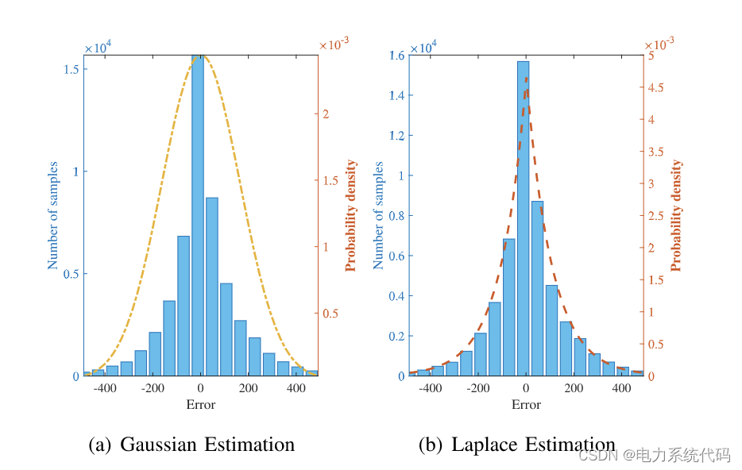
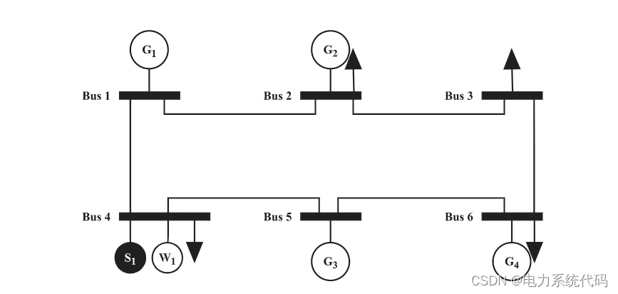
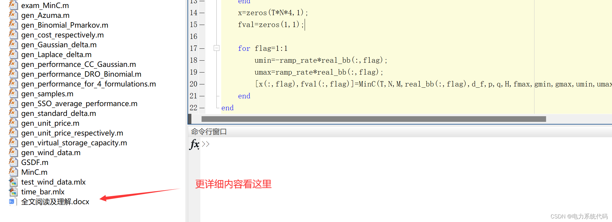
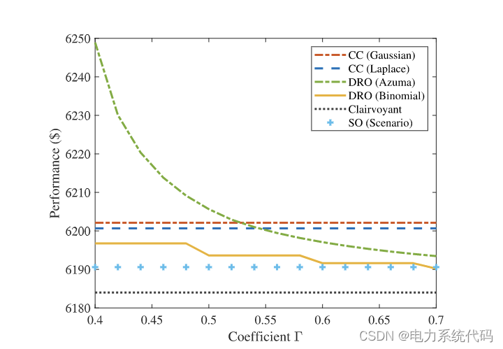
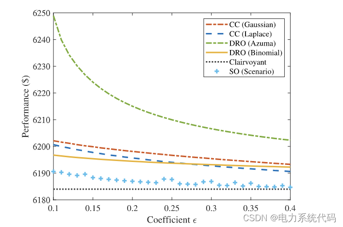
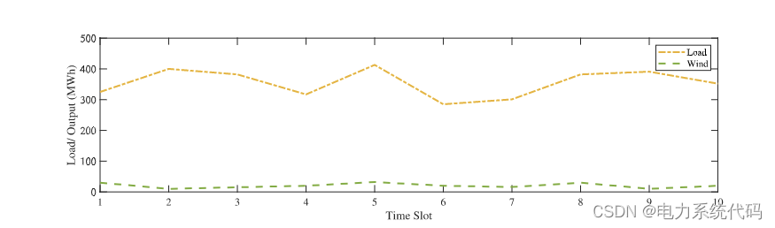
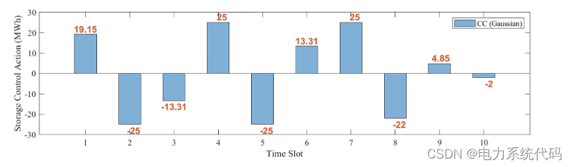
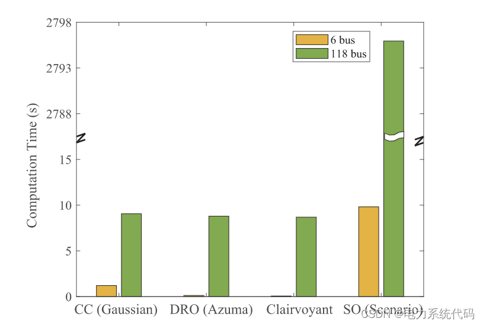

# MATLB|Economic Scheduling with Energy Storage and Robust Optimization with Opportunistic Constraints

​  
👨‍🎓 Blog blogger's extracurricular interest: Eastern and Western philosophical thought, to be given to readers: 👨‍💻 In doing research, it involves a profound system of thought, requiring researchers to be logically precise and diligent. However, relying on others is often more important than just hard work. Moreover, there should be an innovative point and inspirational point that looks up at the stars. When your teacher asks you in philosophy class what science is or electricity is, don't think these questions are funny. Philosophy is about pursuing ultimate questions, seeking those questions that are self-evident but not asked by children, yet you can't answer them. In this column, I will record some philosophical thoughts and scientific notes when I have time: Scientific research and philosophical thinking.It is recommended that readers browse the book in sequence according to the table of contents, so as not to suddenly fall into a dark maze and lose their way back. It is not meant to reveal all the answers to you, but it can certainly raise a cloud of doubts in your mind, which might lead to a different scene of colorful sunsets. If it brings you a heavy rain in the spiritual world, then take this opportunity to wash away the dust on the "truth" that was originally stored there.Perhaps, after the rain, the clouds have cleared, and the sky is clearer...🔎🔎🔎📋📋📋 The following is the outline of this article:⛳️⛳️⛳️: 1. Overview 2. Opportunity Constraint Method 3. Case Studies and MATLAB Code Implementation 3.1. Case Studies 3.2. MATLAB Code 3.3. Results 4. Final Thoughts
1. Overview
IT is a widely held belief that global warming is advancing. Therefore, urgent and effective carbon emission reduction policies must be implemented, such as carbon taxes, total control, and trading. New theories suggest that these policies can reduce reliance on carbon-intensive energy sources, encourage renewable energy, and thus correct negative environmental externalities.However, in practice, the current carbon emission reduction policies may increase regional electricity prices and cause economic issues such as inefficiency and unequal distribution. Therefore, they have not been widely implemented. However, after the outbreak of the COVID-19 crisis, there has been an opportunity to implement such policies in practice. Despite the manufacturing stagnation caused by the coronavirus crisis, it also slowed down the trend of global warming, as the carbon emissions in the energy sector decreased by 3.8% year-on-year in the first quarter of 2020. On the one hand, low carbon levels make the costs associated with carbon reduction policies lower when implemented. To maintain this cost level while returning to normal production, this period of stagnation is an excellent opportunity for carbon-intensive industries to undergo transformation for their own economic interests.On the other hand, this transformation can increase employment and thus address their social issues. Therefore, it is urgent to leverage this valuable period to enhance the practicality of carbon reduction policies.
In the electricity sector, a carbon tax is a common environmental policy aimed at reducing carbon dioxide emissions, but is often considered economically unfavorable, especially in regions dependent on coal-fired and other carbon-intensive generators. Utilizing an energy storage system in the power grid could be a promising solution to alleviate the economic pressures of implementing a carbon tax in grid areas. As clean energy (such as solar and wind power) continues to develop, in this work, we describe stochastic emission-aware economic dispatch with storage systems using two frameworks (i.e., opportunity-constrained framework and robust optimization framework). We highlight their differences and connections by studying the trade-off between robustness and overall cost.Specifically, we link these two frameworks to a novel distributed robust optimization framework that considers real-world boundaries to estimate the best system performance under reliability requirements. Numerical studies on the IEEE-6 node model and IEEE-118 node further confirm this.
2. The two most widely used optimization methods for handling uncertainty are stochastic optimization (SO), which includes the CC method and the RO method. Traditional SO methods are typically based on scenarios. The motivation behind using the CC method is to avoid excessive system redundancy, indicating that certain constraints can be violated within a limited timeframe. Optimization problems under uncertainty often take the following form:
​
Where ε is the objective function; u is a vector of state variables (e.g. SOC); x is a vector of decision variables (e.g., power outputs of each generator); ζ is a vector of random variables (e.g., renewable output). Equations (2 b) and (2 d) represent deterministic constraints. In (2 c), the bar represents the risk level, indicating that the embedded constraints should at least have a probability. In this section, we initially describe the CC optimization problem using general routines, then simplify it using the concept of preventive control, a common practice in power systems.
3 Examples and Matlab Code Implementation
3.1 The example is evaluated by numerical research on the improved 6-node system and the IEEE 118-node system to assess the proposed method. In the first test case, the focus is on numerically comparing CC, DRO, and perspective scenes, where renewable energy generation is considered perfect. Data from the dataset in this paper are extracted for renewable energy, providing information about forecasted and actual wind energy data at a resolution of 5 minutes. Figure 1 plots histograms of error samples. For the CC problem, we need to estimate the distribution model of prediction errors.Specifically, two unimodal distributions are employed to fit the raw samples, namely Gaussian and Laplace distributions, as shown in Figure 1(a) and Figure 1(b), respectively. Regarding RO, we need to determine the upper limit (i.e., Mn) of expected absolute prediction error. To prevent the impact of outliers, we only consider samples within the range from 0.1-quantile to 0.9-quantile and take the average of all absolute values to approximate the upper limit. In practice, if it is allowed for us to reduce excess wind power or decrease unfulfilled load when wind power exceeds the selected interval, the estimation remains effective.
​  
Figure 1: Gaussian and Laplace estimation of wind forecast error
​  
Figure 3 IIIE6 structure diagram
​  
Figure 3: IEEE118 structure diagram
3.2 Matlab Code: This document only displays a portion of the code, the complete code can be found in:
%% Gaussian distribution\nfunction [x,fval]=gen_performance_CC_Gaussian(T,N,M,bb,d_f,p,q,H,fmax,gmin,gmax,ramp_rate,epsilon,gamma,error_data,w_loc,w_num,DR,UR)\n    virtual_bb=[bb bb bb];\n    real_bb=zeros(N,1);\n    if sum(bb)~=0\n        for flag=1:1\n            for k=1:w_num\n                i=w_loc(k);\n                virtual_bb(i,flag)= gen_virtual_storage_capacity(bb(i),epsilon,T,gamma,error_data,flag);\n            end\n            [standard_delta,real_bb(:,flag)]= gen_standard_delta(bb,virtual_bb(:,flag),w_loc);\n        end\n    end\n    x=zeros(T*N*4,1);\n    fval=zeros(1,1);\n\n    for flag=1:1\n        umin=-ramp_rate*real_bb(:,flag);\n        umax=ramp_rate*real_bb(:,flag);\n        [x(:,flag),fval(:,flag)]=MinC(T,N,M,real_bb(:,flag),d_f,p,q,H,fmax,gmin,gmax,umin,umax,DR,UR);\n    end\nend\n  
​  
3.3 Results
​​​​​​​​  
​  
​  
​  
4. End Note: The references to theoretical works are from online sources, and if any infringement is found, please contact the blogger for removal.
​  

## Images

<!-- PAYMENT_BLOCK -->

## Get this dataset

- Payment link (Stripe): [Buy now](https://buy.stripe.com/3cs8yP7sY87d0vu9AB)
- Payment QR code: 

<!-- /PAYMENT_BLOCK -->
